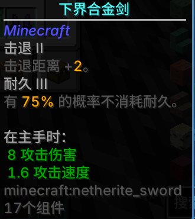
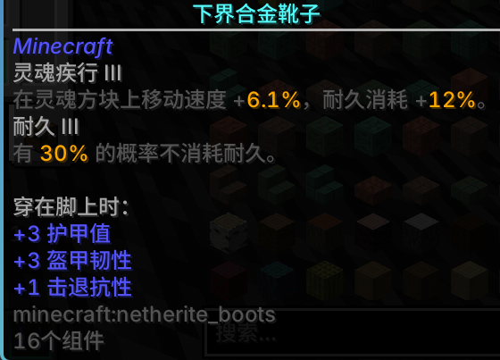

> **AI disclosure**: this mod was written with AI assistance (DeepSeek Harness) on the author's machine. The author reviewed the code and tested every release in-game.

# Detailed Enchantment Descriptions · 详细附魔描述

Adds a short description under every enchantment in item tooltips, with the numbers computed from
the enchantment's own data — so it always matches what the game actually does at that level.

在原版（及部分模组）附魔名字下方加一行描述，数值直接读游戏数据，**当前等级是多少就显示多少**。

---

## Supported versions

| Loader | Minecraft | File |
|---|---|---|
| Fabric | 1.21.1 | `detailed_enchantment_descriptions-1.0.0+1.21.1.jar` |
| Fabric | 1.21.4 | `detailed_enchantment_descriptions-1.0.0+1.21.4.jar` |
| Fabric | 1.21.8 | `detailed_enchantment_descriptions-1.0.0+1.21.8.jar` |
| Fabric | 1.21.11 | `detailed_enchantment_descriptions-1.0.0+1.21.11.jar` |
| NeoForge | 1.21.1 (21.1.265+) | `detailed_enchantment_descriptions-neoforge-1.0.0+1.21.1.jar` |

Client side only. Fabric needs Fabric API; NeoForge needs nothing else. Mod Menu is optional on
Fabric (settings entry point).

## Features

* **42 vanilla enchantments** covered, each with a one-line description of the current level.
* **Numbers come from the game**: `Enchantment#getEffect` / `LevelBasedValue` on Fabric and
  `Enchantment#getEffects` / `LevelBasedValue` on NeoForge — no hard-coded tables that go stale.
* **Config screen** (`/ded`, key bind or Mod Menu): toggle descriptions / numbers / books, colour
  picker with HSV wheel, presets and `#RRGGBB` input.
* **Hold-a-key mode**: optionally only show descriptions while a key is held (rebindable).
* **JSON overrides** for any enchantment (including other mods'): drop a file into a resource pack or
  the config folder, pick `replace` / `append` / `hide`. See [docs/EXTENDING.md](docs/EXTENDING.md).
* **Commands**: `/ded reload`, `/ded dump <id>`, `/ded export <id>`.
* Chinese and English translations, numbers formatted without trailing `.0`.
* Respects the vanilla "hide enchantments" flag.

## Screenshots

| Sword | Boots |
|---|---|
|  |  |
| **Enchanted book** | **Colour picker** |
|  |  |

> The rounded tooltip frame and smoother text rendering in these screenshots come from other
> client mods (tooltip styling / font rendering), not from this one.

## Installation

1. Install Fabric Loader or NeoForge for your Minecraft version.
2. Put the matching jar (and Fabric API on Fabric) into `mods/`.
3. Remove other enchantment description mods to avoid duplicated lines.

## Configuration

Open with `/ded`, `/dedconfig`, the rebindable "Open settings" key, or Mod Menu on Fabric.
Settings are stored in `config/detailed_enchantment_descriptions.json`.

## Extending

Any enchantment can be described without code. Put a JSON file in

* a resource pack: `assets/<any namespace>/enchantment_descriptions/<name>.json`, or
* the config folder: `config/detailed_enchantment_descriptions/enchantments/<name>.json`

The config folder wins over resource packs. Run `/ded reload` after editing the config folder
(`F3+T` for resource packs). Full schema: [docs/EXTENDING.md](docs/EXTENDING.md).

```json
{
  "schema": 1,
  "enchantment": "minecraft:sharpness",
  "mode": "append",
  "lines": [
    { "type": "text", "text": "锋利：这把武器更锋利了。" }
  ]
}
```

## Building

Fabric (one jar per version; writes into `../dist/`):

```bash
node tools/build-version.mjs 1.21.1 1.21.4 1.21.8 1.21.11
```

NeoForge 1.21.1 (writes `build/libs/`):

```bash
cd neoforge
gradle build --offline
```

Requires JDK 21. Version specific Fabric code lives in `src/versions/<version>/` and `overlays/`;
NeoForge sources use Mojang mappings.

## How the values are read

* Value effects (`damage`, `damage_protection`, `knockback`, …): the enchantment's effect list is
  evaluated at the current level.
* Attribute effects (`efficiency`, `depth_strider`, `sweeping_edge`, …): the attribute bonus is read
  from `attributes`, or from `location_changed` for enchantments like Soul Speed.
* Damage reduction: every point of `damage_protection` is 4% (capped at 20 points = 80%).
* A few values live in vanilla code rather than in enchantment data (for example Flame's 5 seconds);
  those are documented where they are used.

## Credits

Inspired by [Exact Enchantments](https://modrinth.com/mod/exact-enchantments) by Ronidas (MIT).
This is an independent reimplementation for newer Minecraft versions; no code was copied.

## License

MIT.
