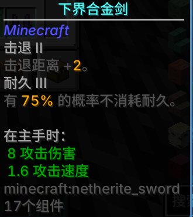
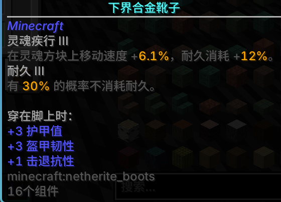
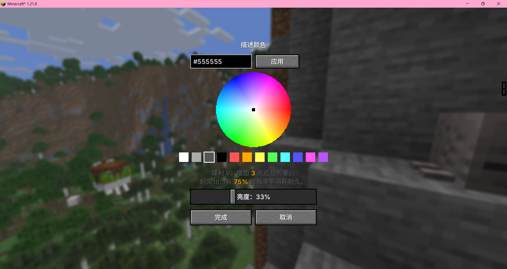

> **AI 声明**：本模组是在 AI（DeepSeek Harness）辅助下完成的，作者本人只在游戏内实测了每个版本。

# 详细附魔描述 · Detailed Enchantment Descriptions

[English](README.md) | **简体中文**

在物品提示框里，为每个附魔名字下方加一行简短描述；数值直接读取附魔自身的数据，**当前等级是多少就显示多少**，与游戏实际行为保持一致。

---

## 支持的版本

| 加载器 | Minecraft | 文件 |
|---|---|---|
| Fabric | 1.21.1 | `detailed_enchantment_descriptions-1.0.0+1.21.1.jar` |
| Fabric | 1.21.4 | `detailed_enchantment_descriptions-1.0.0+1.21.4.jar` |
| Fabric | 1.21.8 | `detailed_enchantment_descriptions-1.0.0+1.21.8.jar` |
| Fabric | 1.21.11 | `detailed_enchantment_descriptions-1.0.0+1.21.11.jar` |
| NeoForge | 1.21.1 (21.1.265+) | `detailed_enchantment_descriptions-neoforge-1.0.0+1.21.1.jar` |

仅客户端模组。Fabric 需要 Fabric API；NeoForge 不需要其它前置。Fabric 上可选装 Mod Menu（提供设置入口）。

## 功能

* 覆盖 **42 个原版附魔**，每个都有一行当前等级的说明。
* **数值来自游戏本身**：Fabric 用 `Enchantment#getEffect` / `LevelBasedValue`，NeoForge 用 `Enchantment#getEffects` / `LevelBasedValue`——不是写死的表格，不会过期。
* **设置界面**（`/ded`、按键或 Mod Menu）：可开关描述 / 数值 / 附魔书，颜色选择器支持 HSV 色盘、预设色和 `#RRGGBB` 输入。
* **按住才显示**：可选只在按住某个按键时显示描述（按键可重绑定）。
* **JSON 覆盖**：任何附魔（包括其它模组的附魔）都能自定义——把文件放进资源包或配置目录，支持 `replace` / `append` / `hide`。详见 [docs/EXTENDING.md](docs/EXTENDING.md)。
* **命令**：`/ded reload`、`/ded dump <id>`、`/ded export <id>`。
* 中英双语，数字不带多余的 `.0`。
* 尊重原版"隐藏附魔"标志。

## 截图

| 剑 | 靴子 |
|---|---|
|  |  |
| **附魔书** | **色盘** |
|  |  |

> 截图里的圆角提示框和更平滑的字体来自其它客户端模组（提示框美化 / 字体渲染），不是本模组提供的。

## 安装

1. 为你的 Minecraft 版本安装 Fabric Loader 或 NeoForge。
2. 把对应版本的 jar（Fabric 还要 Fabric API）放进 `mods/`。
3. 移除其它附魔描述类模组，避免重复显示。

## 配置

用 `/ded`、`/dedconfig`、可重绑定的"打开设置"按键，或 Fabric 上的 Mod Menu 打开。
配置保存在 `config/detailed_enchantment_descriptions.json`。

## 自定义文案

任何附魔都可以不改代码就改文案。把 JSON 文件放到：

* 资源包：`assets/<任意命名空间>/enchantment_descriptions/<名字>.json`，或
* 配置目录：`config/detailed_enchantment_descriptions/enchantments/<名字>.json`

配置目录优先于资源包。改完配置目录后执行 `/ded reload`（资源包用 `F3+T`）。完整格式见 [docs/EXTENDING.md](docs/EXTENDING.md)。

```json
{
  "schema": 1,
  "enchantment": "minecraft:sharpness",
  "mode": "append",
  "lines": [
    { "type": "text", "text": "锋利：这把武器更锋利了。" }
  ]
}
```

## 构建

Fabric（每个版本一个 jar，输出到 `../dist/`）：

```bash
node tools/build-version.mjs 1.21.1 1.21.4 1.21.8 1.21.11
```

NeoForge 1.21.1（输出到 `build/libs/`）：

```bash
cd neoforge
gradle build --offline
```

需要 JDK 21。Fabric 的版本专属代码在 `src/versions/<版本>/` 和 `overlays/`；NeoForge 源码使用 Mojang 映射。

## 数值是怎么读的

* 数值类效果（`damage`、`damage_protection`、`knockback` 等）：按当前等级计算附魔的效果列表。
* 属性类效果（`efficiency`、`depth_strider`、`sweeping_edge` 等）：从 `attributes` 读取属性加成；灵魂疾行这类从 `location_changed` 读取。
* 伤害减免：`damage_protection` 每 1 点 = 4%（最多 20 点 = 80%）。
* 少数数值写死在原版代码里而不是附魔数据中（例如火焰附加/火矢的燃烧时间），这些在使用处有注释说明。

## 致谢

灵感来自 Ronidas 的 [Exact Enchantments](https://modrinth.com/mod/exact-enchantments)（MIT）。本项目是面向新版本 Minecraft 的独立重构，未复制其代码。

## 许可证

MIT。

---

### ⚠️ 作者的话

大家好呀！这是我的**第一个开源项目**，我真的真的还是个初学者！

我想坦诚说明：**这个项目的全部代码是在 AI 的帮助下生成的**。因此它可能存在一些缺陷、不够打磨的代码，或者实现得不够完美的地方。（其实我就是跟ai许愿然后尽量测试出bug而已XD）

我分享出来是为了学习和改进。任何反馈、建议或 PR 都非常欢迎。感谢你的理解与支持！
